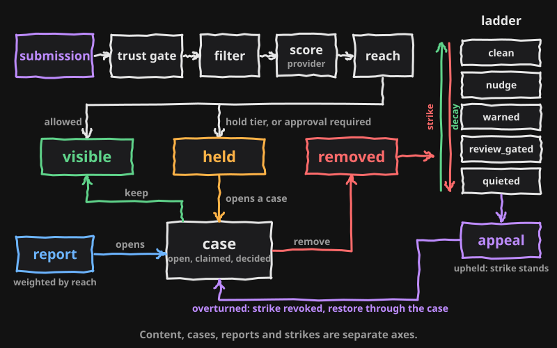
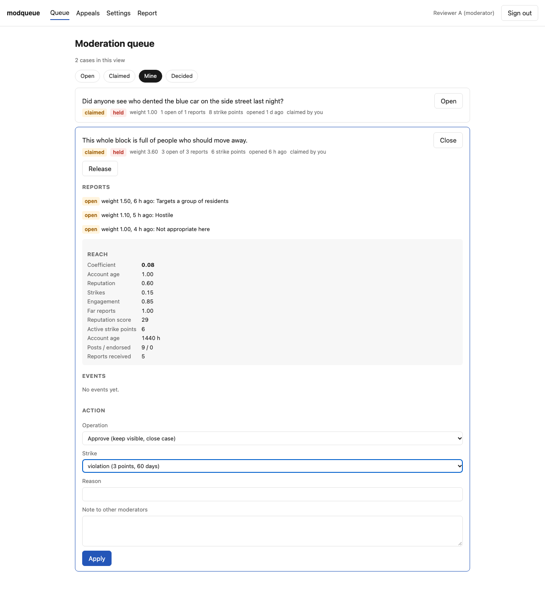
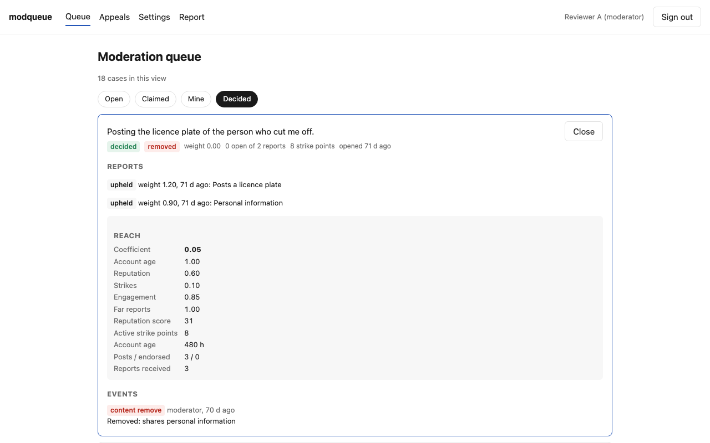
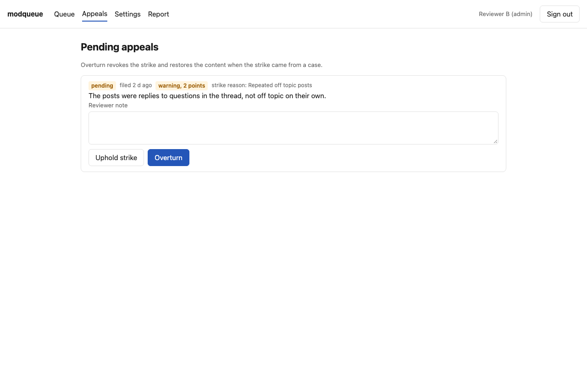

# modqueue

A moderation and anti-abuse kit: trust-weighted reports with decay, a reach coefficient, a consequence ladder with appeals, and an RLS-first Supabase schema, as a TypeScript library with no server, no SaaS and no model.

## What it does

- Reports are weighted by the reporter's reach and summed; content is held when the open weight reaches a threshold, and reporter identity is purged after a retention window.
- A reach coefficient from account age, reputation, active strikes, engagement and far-report rate scales content lifetime, notification fan-out and report weight.
- Strikes carry points that decay, and a ladder of consequences (clean, nudge, warned, review_gated, quieted) notifies on the way up and stays silent on the way down; an appeal can revoke a strike and restore the content through the same case.
- One baseline SQL migration with RLS on every table, revoked default grants, four client-callable functions each covered by pgTAP, atomic case rulings and pgTAP allow and deny tests per role.




The state model, every transition and who can do what are in [docs/model.md](docs/model.md). Every default is in [docs/thresholds.md](docs/thresholds.md). The SQL objects, grants and function behaviour are in [docs/contract.md](docs/contract.md).

## How a submission flows

The core runs against an in-memory store and a fixture provider, so this needs no database and no key.

```ts
import { createFixtureProvider, createInMemoryStore, defaultConfig, noopNotifier, recordSubmission, screenSubmission, systemClock } from 'modqueue'

const store = createInMemoryStore()
const deps = { store, provider: createFixtureProvider(), notifier: noopNotifier, clock: systemClock, config: defaultConfig }

const userId = crypto.randomUUID()
const accountCreatedAt = new Date(Date.now() - 30 * 24 * 60 * 60 * 1000).toISOString()
store.addUser({ id: userId, createdAt: accountCreatedAt })

const result = await screenSubmission(
  { text: 'Found a set of keys by the north gate this morning.', userId, accountCreatedAt, reputationInputs: null, role: 'member', baseTtlHours: 72 },
  deps,
)
if (!result.allowed) throw new Error(result.rejection ?? 'rejected')

const content = store.addContent({ ownerId: userId, body: result.clean, moderationState: result.initialState })
const { automation } = await recordSubmission(content.id, result, deps)

console.log(result.initialState, result.trust.level, result.consequence.tier, result.reach.coefficient.toFixed(2), automation?.logged)
// visible full clean 0.80 ai_flag
```

`screenSubmission` runs the trust gate, the daily cap, the ladder gate, the filter, the provider score and reach, and returns the initial state plus the events to write. The host stores the row, then `recordSubmission` writes those events and runs the automation matrix. Under the default `assist` level the matrix writes a shadow log and changes nothing.

## What ships

| Part | Path | What it is |
|---|---|---|
| Core | `src/`, published as `modqueue` | Trust tiers, reputation, reach, the ladder, scoring, the automation matrix, the action spine, stock messages, the content filter (normalizer, PII patterns, English and French prompt-injection tripwire), a store-agnostic rate limiter, Zod schemas, an in-memory store, three providers (`allow_all`, fixture, OpenAI) |
| Supabase adapter | `src/supabase/`, published as `modqueue/supabase` | `ModerationStore` on `supabase-js`, the queue loader with admin-only identity, claim and release, appeals |
| SQL kit | `supabase/migrations/0001_modqueue.sql`, `supabase/tests/`, `supabase/seed.sql` | The baseline schema, RLS, functions, the queue view, the sweep and purges, both probes, pgTAP tests, a fixture seed |
| Reference admin | `examples/admin/` | A Next.js app with the queue, appeals and settings pages on invented fixtures, a seed script and two Playwright tests |

## Install

Requirements: Node 22.11 or newer, the Supabase CLI, and a Supabase project (local or hosted). The package is installed from a clone; it is not on npm.

#1 - Clone and install.

    git clone https://github.com/jburcsik/modqueue.git && cd modqueue && npm ci

Expected: `node_modules/` exists. The package has no install scripts.

#2 - Build.

    npm run build

Expected: `dist/index.mjs`, `dist/index.cjs`, `dist/index.d.mts`, `dist/index.d.cts` and `dist/supabase/` exist.

#3 - Pack and install into the host, or link.

    npm pack
    cd /path/to/host && npm install /path/to/modqueue/modqueue-0.1.0.tgz

Expected: `import { screenSubmission } from 'modqueue'` and `import { createSupabaseStore } from 'modqueue/supabase'` resolve with types. `npm link` in this repository and `npm link modqueue` in the host work the same way for local development.

#4 - Apply the schema.

    cp supabase/migrations/0001_modqueue.sql /path/to/host/supabase/migrations/20240101000000_modqueue.sql
    cd /path/to/host && supabase db reset

Expected: `select * from public.client_callable_definer_functions();` returns exactly `get_my_role`, `get_my_strike_count`, `file_report` and `file_appeal` with `authenticated` true and `anon` false; `select * from public.security_definer_functions_without_search_path();` returns no rows. Use `supabase db push` for a hosted project. The file is idempotent.

#5 - Create roles.

    insert into public.moderation_roles (user_id, role, display_name) values ('<auth user id>', 'moderator', 'Reviewer A');

Expected: `get_my_role()` returns `moderator` for that session. Members need no row.

#6 - Point the kit at the host's content.

Replace the example table with an updatable view named `public.moderation_content` over the host table, exposing `id`, `owner_id`, `moderation_state`, `created_at` and `body` (nullable), then recreate the trigger `trg_open_case_for_held` on the base table so a change to `held` still opens a case. Optionally replace `public.moderation_reputation_inputs` with a view over the host's own counts. Expected: `select * from public.moderation_queue limit 1;` as `service_role` returns the host's rows.

#7 - Optional provider key.

Pass `OPENAI_API_KEY` to `createOpenAIModerationProvider({ apiKey })`. Without a key, use `allowAllProvider`; every submission then scores clean and the trust gate, filter, reports and ladder still apply. Expected: a submission screened with the key returns a scoring tier; a provider failure is an `unavailable` outcome, never a verdict.

#8 - Wire the host.

Implement `Notifier` (or pass `noopNotifier`), implement `Authorizer` for the server framework, enforce `reach.visibilityFloor` in the read path, and either install `pg_cron` or call `sweep_expired_strikes()`, `purge_report_identities()` and `purge_orphaned_moderation()` from the host's scheduler. Expected: the first strike that reaches `ladder.warned` calls `Notifier.onTierEscalated` once.

## Run the reference admin

#1 - Start the local database from the repository root.

    supabase start && supabase db reset

Expected: `supabase status` prints the API URL and keys; the migration and seed applied.

#2 - Build the kit and install the app.

    npm run build && cd examples/admin && npm install

Expected: `node_modules/modqueue` resolves to the repository root.

#3 - Copy `examples/admin/.env.example` to `examples/admin/.env.local` and paste the anon and service-role keys from `supabase status`. Leave `OPENAI_API_KEY` empty.

#4 - Seed and start.

    npm run seed && npm run dev

Expected: the seed prints the fixture accounts; http://127.0.0.1:3100/login accepts `moderator@example.com` or `admin@example.com` with the seed password, and `/admin/moderation` lists the seeded cases. Pages and routes are listed in [examples/admin/README.md](examples/admin/README.md).







## Tests

| Command | Where it runs | What it covers |
|---|---|---|
| `npm test` | Node, in-memory store | Trust tiers and reputation, reach factors and lifetime clamps, the ladder, tier boundaries and the `off` switch, the automation matrix, the action spine, stock messages never quote a threshold, the filter, normalizer strip counts, the English and French tripwire, the rate limiter failing closed, queue identity shaping, schemas, and that every SQL CHECK list in the migration equals the matching `as const` array in `src/types.ts` in value and order |
| `supabase test db` | pgTAP on `supabase start` | One allow and one deny test per policy and role, the report and appeal guards, atomic case rulings, the single open case index, held opens a case, strike expiry and revocation, the sweep release guard, the purges, both probes |
| `npm run test:integration` | Node against `supabase start` | The action spine end to end, appeal overturn restoring content through `decide_moderation_case`, queue shaping, rate limits, reach and reputation parity between SQL and TypeScript |
| `cd examples/admin && npm run test:e2e` | Playwright, Chromium | A queue action closes a case; an appeal overturn restores the content |

`npm run lint` runs ESLint and `tsc`. `npm run check:package` runs publint, arethetypeswrong and `npm pack --dry-run`. CI runs all of the above.

## Security model

- The boundary is the database. Members reach it through four SECURITY DEFINER functions, `get_my_role()`, `get_my_strike_count()`, `file_report(target_id, reason, evidence_paths)` and `file_appeal(strike_id, statement)`, plus a select on their own appeals and on visible content. Each function takes identity from `auth.uid()` and raises when it is null, pins `search_path`, rate-limits inside the function, and has execute revoked from `public` and `anon`.
- RLS is enabled on every table and the default grants are revoked before the kit's grants are applied. Cases, reports, strikes, events, settings and the queue view are reachable by `service_role` only. Moderators and admins have no direct grants; they act through the kit's server functions behind an `Authorizer` that reads `moderation_roles`.
- Two probes ship in the migration and in pgTAP: `client_callable_definer_functions()` must return exactly the four functions above, and `security_definer_functions_without_search_path()` must return no rows.
- `moderation_events` is append-only and every action writes exactly one row. `decide_moderation_case` changes content state, resolves reports, closes the case and writes the audit row in one transaction.
- Report trust weight, the age gate, self-report, one open report per reporter per target and evidence path shape are enforced in SQL, not in the client. A forged appeal on another member's strike is rejected at insert.
- The host must keep the service-role key on the server, implement `Authorizer`, enforce `reach.visibilityFloor` in its read path, recreate the hold trigger on its own table, run the sweep and purges, and keep its tuned values and word lists out of its public repository.

To report a security problem, use the repository's private vulnerability reporting on GitHub rather than a public issue.

## Limits

- The kit supports silent visibility reduction; it is configurable and can be disabled; operators carry their own transparency obligations.
- Every threshold, weight, window and band in `defaultConfig` is illustrative. The blocked term, profiling phrase and keyword lists are empty examples. A host loads its own values.
- No production content table ships. `moderation_content` is an example table for the seed, the tests and the reference admin; a host replaces it with a view.
- Reporter outcome notices are coarse by design: a reporter learns that a report resolved, not where the threshold sits.
- Report weight uses the reporter's reach at filing time and the engine does not yet weigh reporter accuracy.
- The far-report factor is inert until the host's reputation view supplies `far_rate`; a host whose client can omit its origin should count a missing origin as far.
- Exposing `get_my_strike_count()` to members is a host choice; revoke it when members should not see their own count.
- The provider path screens text. A host screening binary media must fail closed on an `unavailable` outcome; the text path treats it as allow with no confidence.
- The only provider adapter is OpenAI's moderation endpoint. Any other scorer is an implementation of `ModerationProvider`.
- The reference admin is a reference, not a product: email and password sign-in, no pagination, fixtures only.
- The Supabase queue loader issues one reach call per row and is sized for a moderation queue, not a feed.

## Alternatives

ROOST splits trust and safety tooling into detection, investigation, review and enforcement (https://roost.tools). modqueue is a library for review and enforcement. For a running service rather than a library: Ozone (https://github.com/bluesky-social/ozone) is a moderation service and console for the AT Protocol; Coop (https://github.com/roostorg/coop) is a review console with queues, routing rules and appeals; Osprey (https://github.com/roostorg/osprey) is a real-time rules engine for detection.

The kit was extracted from a live community-safety app whose live values, word lists and tuned rules are not public.

## License

MIT, see [LICENSE](LICENSE).
