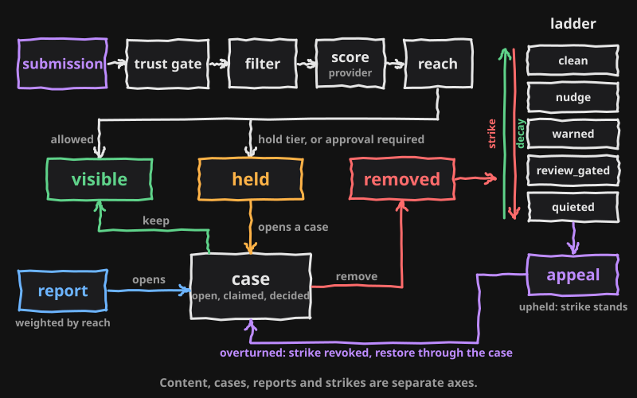

# The moderation model

Content, cases, reports and strikes are separate axes. A piece of content has
a state. A case is the unit of review and closes with a ruling. Reports attach
to a case and resolve when it closes. Strikes land on a member and move them
along a consequence ladder; an appeal can revoke a strike and restore content
through the same case. This page names every state, transition, role and
event. Values live in [thresholds.md](thresholds.md); this page names config
fields only.

## Content states

| State | Meaning |
|---|---|
| `visible` | Shown by the host's read path, subject to `reach.visibilityFloor`. |
| `held` | Hidden pending review. An open case exists for it. |
| `removed` | Hidden by a ruling. Restored only through an appeal. |

### How content enters

`screenSubmission` runs the trust gate, the filter, the provider score and
reach before the host stores anything.

| Check | Refuses with | Otherwise |
|---|---|---|
| Ladder tier forbids posting (`canPost` false) | `posting_paused` | continue |
| Daily cap from the trust tier (`submissionsPerDay`) or the `submit` rate limit | `rate_limited` | continue |
| Filter blocks (`blockedTerms`, `profilingPhrases`, `autoBlockKeywords`) | `content_blocked` | continue |
| Provider score reaches the `hold` tier | none | `initialState` is `held`; the automation matrix then decides what else happens |
| Ladder tier has `requiresApproval` (`review_gated`) | none | `initialState` is `held` with a `tier_hold` event from `system`; the sweep releases it |
| Trust tier has `requiresApproval` | none | `initialState` is `held` with a `content_hold` event from `system`; a moderator releases it |
| Anything else | none | `initialState` is `visible` |

Moderators and admins skip the trust and ladder gates. A provider that is
unavailable is treated as allow with no confidence and never as a verdict.
The host stores the row in `initialState`, then calls `recordSubmission`,
which writes the pending events and runs the automation matrix.

### Content transitions

| From | To | Operation | Actor | Event written |
|---|---|---|---|---|
| new | `visible` | `screenSubmission` allows | pipeline | `tripwire` on a tripwire hit; then `auto_allow` or `ai_flag` from the automation matrix |
| new | `held` | provider tier `hold` | pipeline, then `automated` | `content_hold` when automation acts; `ai_flag` or `escalated` when it does not |
| new | `held` | ladder tier requires approval | `system` | `tier_hold` |
| new | `held` | trust tier requires approval | `system` | `content_hold` |
| `held` | `removed` | `full_auto` at or above the remove floor | `automated` | `content_remove`, `strike_added` |
| `visible` | `held` | `hold` | `moderator`, `admin`, `automated` | `content_hold` |
| `visible` | `held` | open reports' trust weight reaches `autoHideWeight` | `file_report_for` | `content_hold` from `system`; the trigger opens the case |
| `held` | `visible` | `approve` (ruling `keep`) | `moderator`, `admin` | `content_approve` |
| `held` | `visible` | sweep release of a `tier_hold` case | `system` | `content_approve` |
| `visible` | `visible` | `dismiss` (ruling `keep`, reports rejected) | `moderator`, `admin` | `content_approve` |
| `held` or `visible` | `removed` | `remove` (ruling `remove`) | `moderator`, `admin`, `automated` | `content_remove`, plus `strike_added` when the action carries a strike |
| `removed` | `visible` | `restore` after an appeal is overturned | `moderator`, `admin` | `content_restore`, `strike_revoked` |
| any | same | `warn` | `moderator`, `admin`, `automated` | `content_warn`, plus `strike_added` when the action carries a strike (always under `full_auto`) |
| any | same | `note` | `moderator`, `admin` | `mod_note` |

`approve`, `dismiss`, `remove` and `restore` settle a case through
`decide_moderation_case` in a single transaction: content state, open
reports, the case row and the audit row change together or not at all. The
host's read path enforces `reach.visibilityFloor` on `visible` content; the
kit stores the state only.

## Case states

A case is opened by a hold, by the first report on a target, or by a report
that arrives after an earlier case closed. There is never more than a single
open or claimed case per target; a unique index enforces it.

| State | Meaning |
|---|---|
| `open` | Waiting for a moderator. |
| `claimed` | A moderator holds it (`claimed_by`). |
| `decided` | Closed with a ruling of `keep` or `remove`. |
| `reversed` | A `decided` case reopened and closed by `restore`. |

| From | To | Operation | Actor | Notes |
|---|---|---|---|---|
| none | `open` | content becomes `held`; a report is filed | trigger, `file_report_for` | returns the existing open case when there is one |
| `open` | `claimed` | `claimCase` | `moderator`, `admin` | `case_claimed_by_other` when another moderator holds it, unless forced |
| `claimed` | `open` | `releaseCase` | the claimant, or `admin` with force | `forbidden` for anyone else |
| `open` or `claimed` | `decided` | `approve`, `dismiss`, `remove` | `moderator`, `admin`, `automated`, `system` | ruling recorded on the case |
| `decided` | `reversed` | `restore` | `moderator`, `admin` | the appeal path; allowed only when the ruling was `remove`, no later case exists for the target and the content is still `removed`; `case_not_open` otherwise and for any other ruling on a closed case |

Queue order: held content first, then cases with more than a single open
report, then the rest; oldest first within each group.

## Report states

Reports are filed by members through `file_report` and carry the reporter's
reach coefficient as `trustWeight`. They resolve; they are never deleted by a
ruling.

| State | Meaning |
|---|---|
| `open` | Counted toward `autoHideWeight` and shown on the case. |
| `upheld` | The case closed with the flag justified. |
| `rejected` | The case closed with the flag not justified. |
| `duplicate` | Resolved by hand as a duplicate. |
| `withdrawn` | Resolved by hand as withdrawn. |

| From | To | Operation | Actor |
|---|---|---|---|
| none | `open` | `file_report` | `member` |
| `open` | `upheld` | `remove`; also `approve` | `decide_moderation_case` |
| `open` | `rejected` | `dismiss` | `decide_moderation_case` |
| `open` | `duplicate` or `withdrawn` | `resolveReport` | `moderator`, `admin` |

`file_report_for` refuses, in order: `not_found` (no reputation row for the
reporter), `account_too_new`, `rate_limited`, `not_found` (no such target, or
a target that is not `visible`), `self_report`, `invalid_input`,
`duplicate_report`. A reporter
may hold a single open report per target. After `reportIdentityRetentionDays`
the purge nulls `reporter_id` on resolved reports. Reporters learn the
outcome coarsely by design, so that a reporter cannot probe where the line
sits.

## Strikes and the consequence ladder

A strike has a severity, points from `strikes.weights`, and an expiry from
the same table (`decayDays`; null never expires). Active points are the sum
of strikes that are neither revoked nor expired. The tier is the highest
`strikes.ladder` cut-off the active points reach.

| Tier | Begins at | Notice on entry | Message key | Can post | New submissions require approval |
|---|---|---|---|---|---|
| `clean` | below `ladder.nudge` | no | none | yes | no |
| `nudge` | `ladder.nudge` | no | none | yes | no |
| `warned` | `ladder.warned` | yes | `warning` | yes | no |
| `review_gated` | `ladder.reviewGated` | yes | `review_gated` | yes | yes (`tier_hold`) |
| `quieted` | `ladder.quieted` | yes | `quieted` | no (`posting_paused`) | not applicable |

The notifier is called on each upward tier change and never on the way down.
Decay is silent: when strikes expire the member drops a tier with no notice,
and the sweep releases content that the `review_gated` tier held. A `warn`
by `automated` under `full_auto` carries a `warning` strike; a `remove` by
`automated` carries a `violation` strike. Active
strike points also feed the `reach.strikes` factor, so a member's reach falls
with the tier and recovers as strikes expire.

## Appeal states

An appeal targets a single strike. A member files it through `file_appeal`
with a statement; a moderator or admin resolves it.

| State | Meaning |
|---|---|
| `pending` | Waiting for review. A strike may hold a single pending appeal. |
| `upheld` | The strike stands. |
| `overturned` | The strike is revoked. |

| From | To | Operation | Actor | What else happens |
|---|---|---|---|---|
| none | `pending` | `file_appeal` | `member` (the strike's owner) | `appeal_filed` event; refuses with `not_strike_owner`, `strike_inactive`, `rate_limited`, `invalid_input` or `duplicate_appeal` |
| `pending` | `upheld` | `resolveAppeal` with `uphold` | `moderator`, `admin` | `appeal_resolved` event; notice `appeal_upheld` |
| `pending` | `overturned` | `resolveAppeal` with `overturn` | `moderator`, `admin` | strike revoked (`strike_revoked`); when the strike's event is a `content_remove` on a case, `decide_moderation_case` runs `restore` and the content returns to `visible`; `appeal_resolved` event; notice `appeal_overturned` |

A strike whose event is not a `content_remove` (the `warn`, `approve` and
`dismiss` paths, or no case at all) is revoke-only on overturn.

## Who can do what

Members never touch a moderation table directly. They reach the database
through the client-callable functions and a select on their own appeals.
Moderators and admins act through the kit's server functions behind an
`Authorizer`; their role is a `moderation_roles` row and nothing else.

| Action | `member` | `moderator` | `admin` |
|---|---|---|---|
| Submit content (screened by the pipeline) | yes | yes, skipping trust and ladder gates | yes, skipping trust and ladder gates |
| File a report (`file_report`) | yes, when the trust tier has `canReport` | yes | yes |
| File an appeal on own strike (`file_appeal`) | yes | yes | yes |
| Read own role (`get_my_role`) | yes | yes | yes |
| Read own active strike count (`get_my_strike_count`) | host choice | host choice | host choice |
| Read own appeals (without `resolved_by` and `reviewer_note`) | yes | yes | yes |
| Read the queue without identity | no | yes | yes |
| Read the queue with identity, filter by owner | no | no | yes |
| Claim and release a case | no | own claims | any, with force |
| `approve`, `hold`, `warn`, `remove`, `dismiss`, `note` | no | yes | yes |
| Add a strike with an action | no | yes | yes |
| Resolve a report as `duplicate` or `withdrawn` | no | yes | yes |
| Resolve an appeal | no | yes | yes |
| Edit `moderation_settings` | no | no | yes |
| Look up a member (`user_lookup`) | no | no | yes |

`automated` may `hold`, `warn` and `remove` within the automation matrix.
`system` writes `tier_hold`, runs the sweep and the purges.

## Automation matrix

The provider score and the keyword lists give every submission a tier:
`allow`, `allow_log`, `warn` or `hold`, with a confidence equal to the
highest category score. A severe category above `scoring.severeScoreFloor`
is `hold` with severity `severe` regardless of thresholds. A `hold` tier
submission is stored `held` at every level; the `automationLevel` setting
says what the kit writes and whether it goes further. `runAutomatedAction`
runs after the row exists.

| Tier | `off` | `assist` | `semi_auto` | `full_auto` |
|---|---|---|---|---|
| `allow` | nothing, not even a log | `ai_flag` shadow log | `auto_allow` | `auto_allow` |
| `allow_log` | nothing | `ai_flag` shadow log | `auto_allow` | `auto_allow` |
| `warn` | nothing | `ai_flag` shadow log | `ai_flag` shadow log | `content_warn` with a `warning` strike at or above `autoActionConfidence`, else `ai_flag` |
| `hold` | nothing | `ai_flag` shadow log | `content_hold` by `automated` at or above `autoActionConfidence`, else `ai_flag` | `content_remove` with a `violation` strike at or above the larger of `automation.fullAutoRemoveFloor` and `autoActionConfidence`, else `content_hold` |
| severity `severe` | nothing | `ai_flag` shadow log | as `hold` | `escalated` to a human; no automated action |

`full_auto` cannot be saved until `fullAutoAcknowledgedAt` is set; the
database CHECK refuses it. Should the row carry `full_auto` without an
acknowledgement, the kit writes an `escalated` event and runs as
`semi_auto`.

## Events

`moderation_events` is append-only. Every row names a target (`content` or
`user`), a source, a severity and, for content rows, the prior state.

| Event | Written by | When |
|---|---|---|
| `content_hold` | action spine, pipeline, `file_report_for` | `hold` by a moderator, admin or `automated`; a trust tier that requires approval (`system`); open report weight reached `autoHideWeight` (`system`) |
| `content_remove` | `decide_moderation_case` | ruling `remove` |
| `content_restore` | `decide_moderation_case` | ruling `restore` |
| `content_approve` | `decide_moderation_case`, sweep | ruling `keep` (`approve`, `dismiss`); sweep release |
| `content_warn` | action spine | `warn` by a moderator, admin or `automated` |
| `mod_note` | action spine | `note` |
| `strike_added` | action spine | an action carrying a strike |
| `strike_revoked` | appeal resolution | overturn |
| `tier_hold` | pipeline | the `review_gated` ladder tier required approval; carries the release point |
| `ai_flag` | automation | shadow log of what the matrix would have done |
| `auto_allow` | automation | an allow tier under `semi_auto` or `full_auto` |
| `escalated` | automation | severe content under `full_auto`; `full_auto` without an acknowledgement |
| `user_lookup` | server | an admin viewed a member; repeats inside `userLookupDebounceMs` are not written |
| `appeal_filed` | `file_appeal_for` | an appeal was filed |
| `appeal_resolved` | appeal resolution | uphold or overturn |
| `tripwire` | pipeline | a tripwire pattern matched (`system`, no actor; the target content identifies the submission); detect only |

## The sweep

`sweep_expired_strikes` runs on a schedule (`pg_cron` when installed, the
host's scheduler otherwise). It looks at open cases whose content is `held`,
with no open reports, where every event on the case is a `tier_hold`. For
each, when the owner's active strike points have fallen below the release
point stored on the `tier_hold` event (`strikes.ladder.reviewGated`), the
content returns to `visible`, the case closes as `decided` with ruling
`keep`, and a `content_approve` event from `system` records the release.
Content held by a moderator or by `automated` carries a `content_hold` event
and is never released by the sweep. A `tier_hold` whose `release_below_points`
is missing or not an integer is skipped and never released. A hold event with
no `case_id` is not considered by the sweep.

The purges run beside it: `purge_report_identities` nulls `reporter_id` on
reports resolved longer ago than `reportIdentityRetentionDays`, and
`purge_orphaned_moderation` deletes reports and cases whose content row no
longer exists, including rows a host view hides after a soft delete; their
moderation history goes with them.
